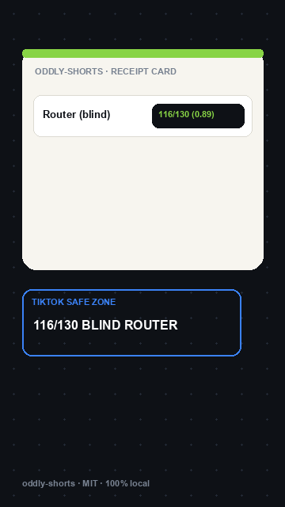

# oddly-shorts

**Animated vertical shorts, made on your own computer: ads, devlogs, demos and true-story explainers.**
Flat bean-head cartoon characters in a colourful, ink-outlined 3D world, a consistent host, live tech screens,
word-synced subtitles, local voice, an original synthesized soundtrack and a QA gate. No AI video generator, no
cloud, no per-video cost. Works as a Claude Code skill (`SKILL.md`) or as plain command-line tools.

Based on **[claude-animated-shorts](https://github.com/mromidev/claude-animated-shorts) by Mr omi** (MIT): its toon
renderer and synthesized audio are the foundation. oddly-shorts adds everything below.

<p align="center"></p>

## What it adds
| | |
|---|---|
| **Character kit** | define a host once (`kit/characters/*.json`: hair, glasses, outfit, colours, pin, pocket prop, head shape) and get the identical character in every video; expression changes hide behind blinks. Presets: `otto` (AI engineer), `marc` (Marc, the ads host), `maya` (designer). |
| **Tech-ad scene library** | desk with two live monitors: typing terminal (generic `lab@mac-studio ~ %` prompt, never your real user or paths), code editor, app screenshots, mock app, animated bar-chart number reveals, before/after split; product cameos on the desk. |
| **Dialogue ads** | a host and a talking cactus buddy with lip-sync, two local voices (one profile per speaker, with a mandatory consent field: no cloning of third-party voices), a camera cut on every line built automatically from the voice timings, top step tags. |
| **Subtitles by default** | word-synced 1-3 word cards, bold rounded type with outline, key-word highlight (`pop`) or `karaoke`, with per-platform safe-zone presets (`tiktok`, `youtube-shorts`, `reels`, `x`, `universal` in `kit/safezones.tsx`). |
| **Overlays & 2D cards** | big before -> after number reveals, lower thirds, end card with your call to action, plus standalone or composable `ReceiptCard`, `SplitBenchmark`, `DiagramExplain` and `NewsReaction` components (`kit/Templates.tsx`). |
| **Ad & receipt formats** | `demo`, `problem-solution`, `devlog`, `launch`, `benchmark`, `dialogue`, `story`, `receipt-card`, `split-benchmark`, `diagram-explain`, `news-reaction`: script skeletons, three hook variants for A/B, plan-driven scenes (edit `plan.json`, not code). |
| **One command per step** | `oddly new / voice / keyframes / audio / render`: script -> Kokoro voice (local) -> faster-whisper word timing -> captions -> scenes -> original score + SFX mix -> render -> QA -> exports 9:16, 1:1, 16:9 + title / caption / hashtags. |
| **QA gate** | specs, duration, loudness (-14 LUFS, true peak <= -1 dBTP), black / frozen frames, subtitle sync and coverage, and a PII scan of every text file and (with tesseract) OCR of the frames: fails on `/Users/`, `/home/`, e-mails, API-key shapes, your user / host name or git identity. |
| **Keyframe check** | one still per camera key with safe-zone guides, so no character ends up outside a 9:16 frame. |
| **Reel editor** (`edit/`) | turns talking-head recordings or AI clips into reels without cutting voice: energy-safe pause removal + cut report, transcript diff after every step, phone-voice chain to -14 LUFS, word-by-word captions, punch-ins, face-tracked overlays (local Apple Vision) that pop above the head or beside a shoulder while the speaker talks (bars, RAM meter + padlock, printing receipt, stamps, chips), storyboard with real frames, 7 hook variants, QA with OCR PII scan. |
| **Anchored overlays (3D)** | the same overlay library for the 3D host: the head is projected through the shot camera every frame (`kit/Anchored.tsx`), so graphics follow camera moves and never cover the face. |
| **Low-RAM mode** | one render at a time, waits for free memory (`ODDLY_MIN_FREE_GB`), `ODDLY_CONCURRENCY=1` for 16 GB machines; macOS and Linux. |

## Quick start
```bash
# inside a Remotion project (npx create-video@latest my-shorts && cd my-shorts)
git clone https://github.com/oddlyprovenai/oddly-shorts ~/.claude/skills/oddly-shorts
~/.claude/skills/oddly-shorts/tools/oddly init
~/.claude/skills/oddly-shorts/tools/oddly new my-first-ad demo
# edit episodes/my-first-ad/voice/script.txt and src/videos/my-first-ad/plan.json, register the composition, then:
oddly voice my-first-ad && oddly keyframes MyFirstAd my-first-ad && oddly audio my-first-ad
oddly render MyFirstAd my-first-ad "01 - My First Ad" out/export
```
In Claude Code you can just say: *"use oddly-shorts to make a 60-second demo ad for my app"*.

## Requirements
Node 18+, Python 3.10+, ffmpeg; optional tesseract. 16 GB RAM works (low-RAM mode); a 60 s short renders in a few
minutes on Apple silicon. Remotion has its own licence (free for individuals and small teams; see remotion.dev/license).

## Examples
`examples/vasa` (a true-story short: a warship that failed its stability test) and `examples/clever-hans` (the horse
that "could count"): complete scripts, scenes and sound. They contain no third-party images.

## Licence
MIT (see `LICENSE`, `LICENSE.claude-animated-shorts`, `NOTICE.md`). Not included: the original skill's private
reference frames.
